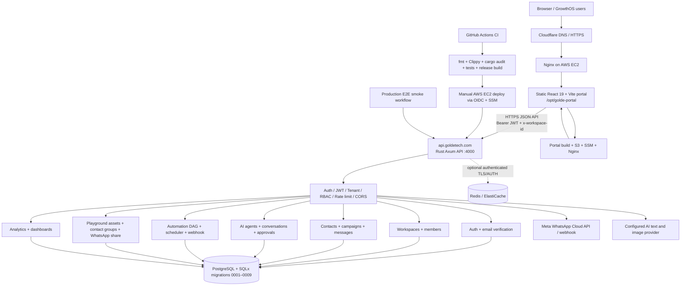

# GOLD-e GrowthOS Marketing API — Architecture and Go-Live Audit

Audit date: 2026-10-12  
Repository: https://github.com/Aakruti7870/Marketing-API-Rust  
Branch audited: main  
Audited commit: 1ca6ae93dbce31adc54b5f69e0476766ba0fd66b

## Current architecture

## Verified repository implementation

- Rust 2021 backend using Axum/Tokio, SQLx/PostgreSQL, JWT, workspace tenancy and RBAC middleware.
- API routes for auth, workspaces, custom domains, contacts, campaigns, messages, agents, public agent chat/widget, analytics, WhatsApp webhooks, automations/webhooks and Playground.
- Migrations 0001–0009 exist, including automation, agents, deployment/custom-domain features, Playground groups/actions and email verification.
- React 19 + Vite frontend exists under frontend/, with a centralized Axios API client using https://api.goldetech.com/api/v1.
- CI runs formatting, dependency audit, database migrations against CI PostgreSQL, Clippy with warnings denied, tests and release compilation.
- Production backend deployment workflow and portal deployment workflow are present.
- Latest recorded backend CI succeeded at commit 1ca6ae93.
- Latest recorded backend production deploy and production E2E smoke runs succeeded on 2026-10-04 at commit 57e21bcd and 8d01c92a respectively (not the current main commit).
- Portal build at 1ca6ae93 succeeded, but its deployment failed: AWS rejected GitHub OIDC role assumption (sts:AssumeRoleWithWebIdentity). A prior portal deployment on 2026-10-01 succeeded at commit f1d67837.

## Go-live blockers / required checks

### P0 — Restore reproducible portal deployment
- Fix AWS IAM OIDC trust policy for role arn:aws:iam::352285845269:role/golde-growthos-portal-deploy to match the current GitHub token subject exactly. Log showed subject:
  repo:Aakruti7870@260543178/Marketing-API-Rust@1383299138:ref:refs/heads/main
- Do not broadly permit all repositories or refs. Verify GitHub OIDC provider audience sts.amazonaws.com and narrowly scoped repository/ref/workflow conditions.
- Re-run portal deployment; confirm it reaches SSM activation and prints GOLD_E_GROWTHOS_PORTAL_DEPLOY_OK.
- Independently confirm https://goldetech.com serves the intended portal bundle and that API calls target https://api.goldetech.com/api/v1.
- The GitHub Actions connector cannot mutate AWS IAM role policies; this item requires AWS-side role trust-policy access or a user with AWS permissions.

### P0 — Deploy and verify current backend commit
- Latest main commit is newer than the latest recorded successful backend deployment. Trigger the manual Deploy to AWS EC2 Production workflow with confirm_production=true after checking the production secrets/environment.
- Confirm local and public /health.
- Confirm migration 0009 is applied on production. Backend startup auto-runs SQLx migrations, but a successful historical deployment does not prove the latest migration ran on live.
- Run production E2E smoke against current deployment.

### P0 — Email verification configuration
- Set production RESEND_API_KEY in /opt/golde-marketing-api/.env, not only in GitHub Actions secrets.
- Verify the sender domain and confirm EMAIL_FROM is valid and authorized with Resend. Current default is GOLD-e GrowthOS <noreply@kryso.dev>; do not assume this sender is verified.
- Confirm FRONTEND_BASE_URL is the actual public portal URL.
- Register a fresh test account; verify email receipt, single-use token expiry, verify link handling, login before/after verification, and resend throttling/privacy behavior.
- Existing users are preserved as verified by migration 0009.

### P0 — External integrations must be live, not simulated
- Verify production WHATSAPP_SIMULATION_MODE=false and Meta Cloud API phone number ID, access token, business account ID, webhook verify token and app secret.
- Send a controlled test message, receive webhook status updates and confirm provider delivery.
- Configure AI_API_KEY and validate text/image generation; avoid claiming AI features are live if only fallback/simulation paths work.
- Validate CHANNEL_ENCRYPTION_KEY before storing channel credentials; check production secrets are stable and sufficiently strong.
- If Redis is configured, verify TLS + AUTH. Redis is optional in current code and job queue/worker processing is documented as separate implementation work.

### P1 — Finish automation feature scope
- Draft PR #1 (“Build native GOLD-e automation engine”) remains open and draft. Review its changes and port/merge the intended missing features only after a careful diff against main; do not blindly merge a stale branch.
- Verify scheduler, scheduled jobs, retries/timeouts, branching/transforms, outbound HTTP SSRF controls, approval resume, webhook authentication, run history and failure handling.
- Verify frontend pause behavior against backend routes: frontend api.js contains pause() calling POST /automations/:id/pause, while the inspected src/routes/automations.rs routes include publish/run/delete but no pause route. This is a potential 404/missing behavior to reconcile.
- Production smoke tests currently cover auth/workspace, manual automation and webhook trigger flows, not every portal feature.

### P1 — End-to-end portal acceptance
- Test signup/email verification/login/refresh/logout.
- Test workspace isolation and OWNER/ADMIN/MEMBER permissions with two workspaces.
- Test contacts CRUD, campaign creation/launch/pause, messages, analytics, agents/chat/approval, automations, Playground image/text generation, CSV imports, WhatsApp share, public assets and custom domains.
- Verify failed or missing third-party credentials are surfaced as a clear UI error; confirm no accidental simulation is reported as successful real delivery.
- Verify mobile responsive layout, browser console/network errors, deep-link fallback, cache behavior and stale service-worker/browser bundle issues.

### P2 — Hardening and operations
- Keep Postgres private; verify backups and restore rehearsal.
- Ensure logs redact credentials, auth tokens, phone numbers and message payloads.
- Add observability/alerts for 5xx, failed outbound sends, scheduler lag, email delivery failure and deployment rollback.
- Reconcile docs stating Redis 7 / authenticated TLS versus code treating Redis as optional and queue workers as not implemented.
- Review password hashing and token storage, request limits, public chat abuse controls, upload size/type limits and retention of public media assets.

## Deployment evidence recorded from GitHub Actions
- CI current main commit 1ca6ae93: success (run 37167985526, 2026-10-04).
- Portal deploy current main commit 1ca6ae93: failure (run 37167985577, 2026-10-04), OIDC role assumption denied.
- Backend deploy success: run 37163728155 at commit 57e21bcd (2026-10-04).
- Production E2E smoke success: run 37165029437 at commit 8d01c92a (2026-10-04).
- Previous portal deploy success: run 36918105470 at commit f1d67837 (2026-10-01).

## Same-day execution order
1. Restore AWS OIDC trust for portal deploy.
2. Deploy current backend commit and verify migration 0009.
3. Configure Resend and verify a real fresh signup.
4. Configure and validate real Meta WhatsApp + AI provider; confirm credentials are not simulation/fallback.
5. Re-run production E2E smoke and perform focused browser acceptance.
6. Fix route/UI mismatches and automation gaps found during acceptance; deploy only after CI is green.
7. Capture final evidence (URLs, commit SHAs, workflow run links and successful test results).

## Important limitation
GitHub repository/workflow history was audited. The GitHub connector does not provide direct shell/HTTP execution against the EC2 host or permission to mutate AWS IAM. Production runtime configuration, live database migration state, real provider delivery, and the current live portal bundle remain to be verified through AWS/server access and public endpoint checks. Do not mark any item done based only on a successful code build.
